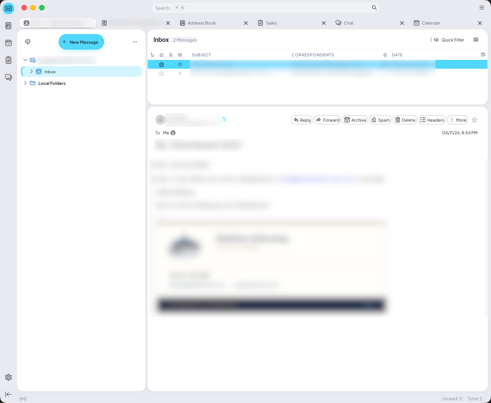
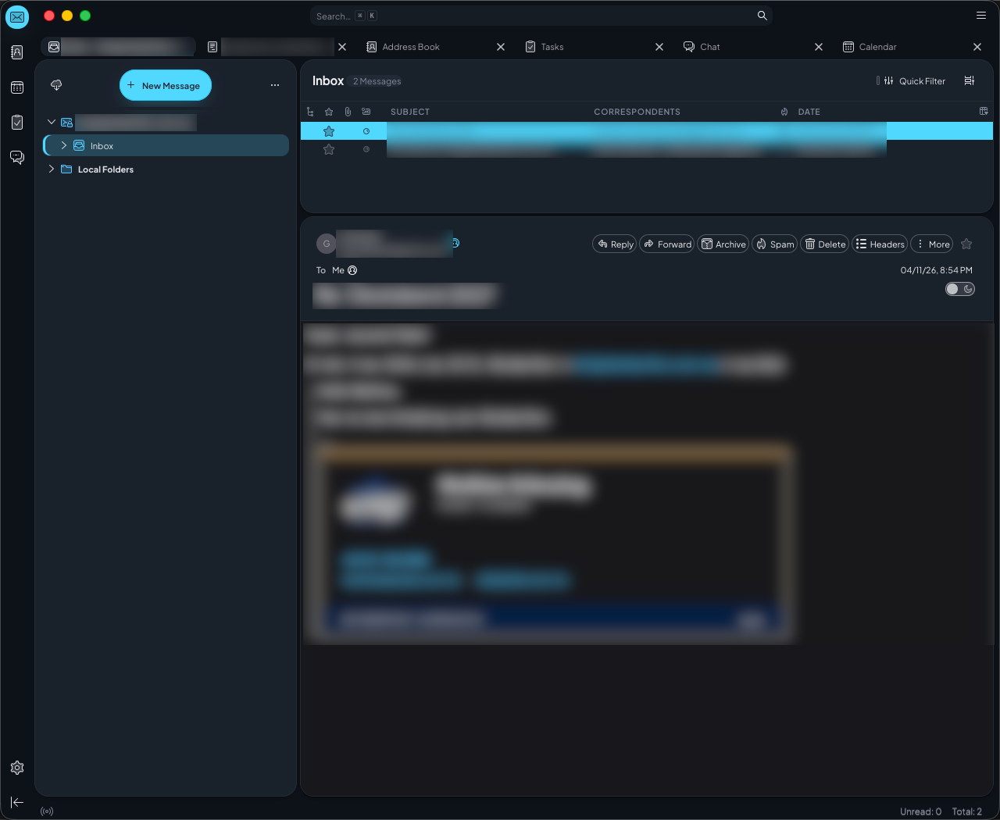
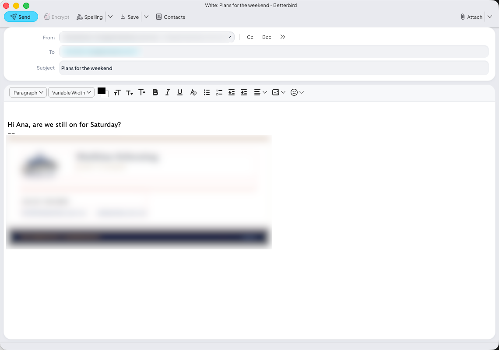
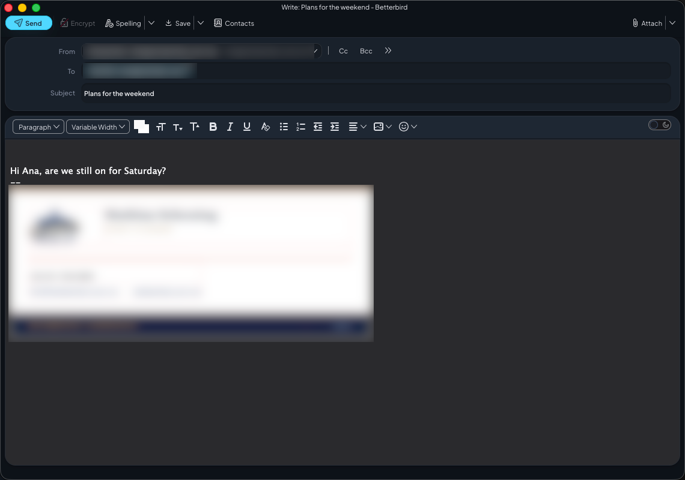

# Plume for Betterbird

A light and dark theme for [Betterbird](https://www.betterbird.eu/). Each pane becomes a soft white card on a matte background, selections and the main buttons get a neon blue accent, and the whole app switches to Plus Jakarta Sans.

Made by [Geowiza](https://geowiza.com/) · [@geowizatpz on GitHub](https://github.com/geowizatpz)

> **Status:** work in progress. The main window, the account overview and the compose window are styled. Settings, dialogs, the address book and calendar are next.

| Light | Dark |
| --- | --- |
|  |  |
|  |  |

Email addresses and message contents in the screenshots are blurred.

## Requirements

- Betterbird 153 (tested on 153.6.0esr-bb12). Other versions may work, but Betterbird updates can change the UI and break individual rules.
- macOS or Linux for the install script. On Windows, copy the files by hand (see below).

## Install

1. Quit Betterbird.
2. Download this repository and open a terminal in its folder.
3. Run:

   ```bash
   ./install.sh
   ```

4. Start Betterbird.

The script finds your default profile, moves an existing `chrome` folder to `chrome.backup-<date>` and turns on `toolkit.legacyUserProfileCustomizations.stylesheets` in `user.js`. To pick a different profile, pass its folder:

```bash
./install.sh --profile "/path/to/your/profile"
```

You find the profile folder in Betterbird under **Help > Troubleshooting Information > Profile Folder**.

### Manual install (Windows, or if you prefer)

1. Open your profile folder as described above.
2. Copy the `chrome` folder from this repository into it.
3. Open **Settings > General > Config Editor**, search for `toolkit.legacyUserProfileCustomizations.stylesheets` and set it to `true`.
4. Restart Betterbird.

## Uninstall

```bash
./uninstall.sh
```

This moves the theme folder aside and puts your old `chrome` folder back, if there was one. Nothing gets deleted.

## Customize

Put your own CSS in `chrome/user-overrides.css`. The installer keeps that file when you update. Colours, radii and spacing are CSS variables starting with `--plume-`, defined in `chrome/tokens/`. For example:

```css
:root {
  --plume-pane-gap: 4px;     /* tighter layout */
}
```

To swap the neon blue accent for lime:

```css
:root {
  --plume-accent: var(--plume-lime-400);
  --plume-accent-hover: var(--plume-lime-300);
  --plume-accent-pressed: var(--plume-lime-500);
  --plume-accent-soft: var(--plume-lime-100);
  --plume-accent-glow: rgba(199, 226, 43, .55);
}
```

In dark mode, set `--plume-accent-soft` to a transparent tint such as `rgba(216, 240, 74, .18)` inside `@media (prefers-color-scheme: dark)`.

Light or dark follows your system setting.

## Project layout

```
chrome/
  userChrome.css      entry point for the app UI
  userContent.css     entry point for the message reader and about: pages
  user-overrides.css  your own tweaks
  tokens/             colours, dark mode, spacing, type, motion
  modules/            main window, compose, dialogs
  content/            message reader, settings pages
  fonts/              Plus Jakarta Sans, JetBrains Mono (OFL)
install.sh / uninstall.sh
scripts/fetch-fonts.sh
scripts/dev-reload.sh   copy the theme into a profile and restart (macOS)
docs/screenshots/
```

## Development

Turn on live reloading of the chrome CSS while you work: open the Config Editor and set `devtools.chrome.enabled` and `devtools.debugger.remote-enabled` to `true`. Then open **Tools > Developer Tools > Developer Toolbox**, where the Style Editor lists `userChrome.css` and its imports.

## Credits

- Fonts: [Plus Jakarta Sans](https://github.com/tokotype/PlusJakartaSans) and [JetBrains Mono](https://github.com/JetBrains/JetBrainsMono), both under the SIL Open Font License 1.1.
- Not affiliated with Betterbird or Thunderbird.

## License

MIT © [Geowiza](https://geowiza.com/), see [LICENSE](LICENSE). The bundled fonts keep their own OFL license.
